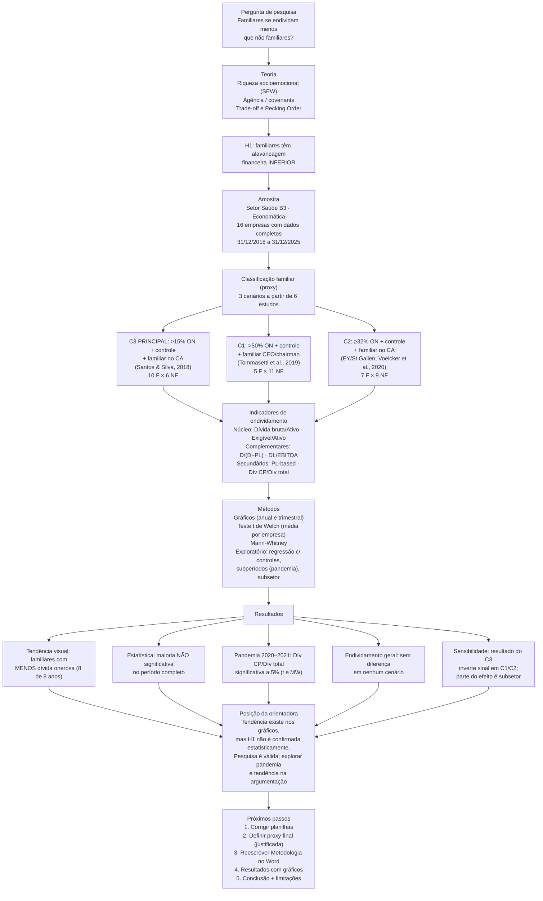
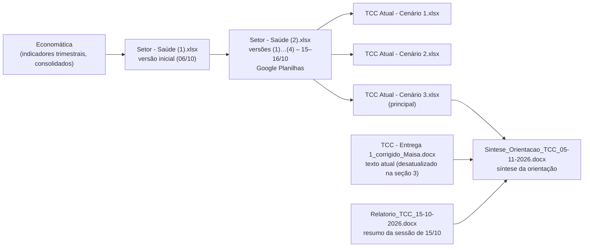

# CONTEXTO DO PROJETO – TCC "Empresas familiares vs. não familiares: comportamentos de endividamento"

> **Para o Claude Code:** este arquivo resume tudo o que foi feito, decidido e concluído até 06/11/2026. Leia-o inteiro antes de mexer nos arquivos. O autor é estudante de Ciências Contábeis; responda em **português**, com linguagem acadêmica quando for texto do TCC e didática quando for explicação.

---

## 0. Identificação

| Item | Valor |
|---|---|
| Autor | Renan do Amaral Ribeiro (Nº USP 12504474) |
| Curso | Ciências Contábeis – FEA-RP/USP (Ribeirão Preto), Departamento de Contabilidade |
| Orientadora | Profa. Maisa Ribeiro |
| Título | Empresas familiares vs. não familiares: comportamentos de endividamento |
| Avaliação | Orientadora + 2 professores avaliam o texto; **não há apresentação/defesa oral** |
| Fase atual | Análise de dados concluída em grande parte; corrigir planilhas e **escrever Metodologia, Resultados e Conclusão** no Word |

---

## 1. Roteiro em grafo (visão geral)

### Grafo dos arquivos

---

## 2. Arquivos do projeto

| Arquivo | Papel | Situação |
|---|---|---|
| `TCC - Entrega 1_corrigido_Maisa.docx` | Texto do TCC (Introdução, Referencial, Metodologia, Referências) com correções controladas e 2 comentários da Maisa ("Exemplos." e "exemplifique") | **Desatualizado**: a seção 3 ainda descreve todas as não financeiras da B3, período 2022–2024 em trechos, alavancagem de mercado, Q de Tobin e **System-GMM** (Blundell & Bond, 1998) – inviável com 16 empresas |
| `TCC Atual - Cenário 3.xlsx` | Planilha principal (C3). É o **arquivo-suporte que vai para a banca**: tudo precisa ser rastreável até a base | Ver erros na seção 10 |
| `TCC Atual - Cenário 2.xlsx` | Mesma estrutura, classificação C2 (robustez) | Mann-Whitney com faixas erradas |
| `TCC Atual - Cenário 1.xlsx` | Deveria ser C1 (robustez) | **Está classificado como C2** – precisa ser refeito |
| `Setor - Saúde (2) (1…4).xlsx` | Versões intermediárias (15–16/10) | Histórico |
| `Relatorio_TCC_15-10-2026.docx` | Relatório da sessão de 15/10 | Histórico |
| `Sintese_Orientacao_TCC_05-11-2026.docx` | Síntese da reunião com a orientadora | Referência atual |

### 2.1 Abas das planilhas "TCC Atual – Cenário X"

| Aba | Conteúdo |
|---|---|
| Metodologias | Texto explicativo do teste t de Welch e do Mann-Whitney + tabela de níveis de significância |
| Indicadores | Tabela: fórmula, o que mede, para que serve e como interpretar cada indicador |
| Análises | Tabela anual (31/12) por grupo + valores por empresa (linhas 20–35) + testes (D38, D39, Mann-Whitney D42:D47). Colunas A/B = subsetor/segmento |
| Div Bruta x Atv t · Exigivel T x Atv t · Estr de Cap · Div Liq x Ebitda · Exig T x Pat Liq · Div Brut x Pl · Div Liq x Pl | Uma aba por indicador: média trimestral por grupo (A3:C32, 29 datas) + gráfico + valores por empresa (linhas 36–51, colunas C:AE trimestres, AF média, AG posto) + teste t (D54, D55) + Mann-Whitney (D58:D63) |
| Saúde - 1218 à 1225 | **Base principal** (16 empresas, intervalo completo) |
| Saúde - 1221 à 1225 | Base parcial (EUFA, VVEO, ONCO, DMVF, MATD) |
| Cópia de Saúde | Cópia de segurança |
| Classificação | 22 empresas: subsetor, segmento, cenários 1–3, intervalo, links e notas do FRE |
| Estudos | Detalhamento dos 6 estudos de classificação (condições para familiar/não familiar) |
| Resumo dos Critérios | Quadro comparativo dos 6 estudos |
| Metodologia | Definição da proxy em 3 cenários, regras comuns, pontos fortes, limitações e recomendação (C3) |
| Cenários | Aplicação empresa a empresa: % ON, composição do bloco, controle, CA, CEO/chairman, C1/C2/C3 |
| Indicadores por cenário | Médias e p-valores por cenário (gerado em 13/10) |
| Dados | Painel empresa-ano (gerado em 13/10) |
| Sem datas | Base geral da Economática (~180 empresas da B3) – só nas versões "Setor - Saúde" |

### 2.2 Layout da base `Saúde - 1218 à 1225`

| Coluna | Conteúdo |
|---|---|
| A | Intervalo |
| B | Familiar? (no arquivo C3 o cabeçalho é "Cenário 3") |
| C | Razão Social |
| D | Nome de Pregão |
| E | Código (ticker) |
| F | Consolidado? |
| G | INDICADORES (nome do indicador na Economática) |
| H … AJ | 29 datas trimestrais, de 31/12/2018 (H) a 31/12/2025 (AJ) |

Colunas de **31/12** de cada ano: 2018 = **H**, 2019 = **L**, 2020 = **P**, 2021 = **T**, 2022 = **X**, 2023 = **AB**, 2024 = **AF**, 2025 = **AJ** (a cada 4 colunas). Valores ausentes vêm como `"-"` (texto). A linha "Meses = 12" indica que fluxos (EBITDA, EBIT, despesa financeira) são **últimos 12 meses**.

---

## 3. Desenho da pesquisa

- **Pergunta:** a estrutura de controle familiar está associada a níveis diferentes de endividamento em companhias abertas brasileiras?
- **H1 (no Word):** empresas de controle familiar apresentam nível de alavancagem financeira inferior ao de empresas não familiares.
- **Base teórica:** SEW (a família evita dívida para não se expor a credores e covenants); Teoria da Agência (Jensen, 1986); covenants e risco de interferência (Costa; Matte; Monte-Mor, 2018); Trade-off e Pecking Order; controle do efeito-setor (Oliveira; Kayo, 2020). Força oposta: preservação do controle pode levar a preferir dívida a emitir ações (diluição). Literatura inconclusiva (Kayo; Brunaldi; Aldrighi, 2018; Wildner; Oro; Petry, 2020; Pestana; Gomes; Lopes, 2021); Poletti-Hughes & Martínez Garcia (2022) acham familiares **mais** alavancadas, com U invertido (~64%).
- **Amostra principal:** setor de saúde da B3, empresas com dados completos de 31/12/2018 a 31/12/2025 → **16 empresas**.
- **Excluídas por intervalo incompleto:** DMVF (desde 12/2019), EUFA (12/2020), ONCO (12/2020), VVEO (12/2020), MATD (09/2021), PGMN (09/2022).
- **Frequência:** gráficos podem ser trimestrais (posições de balanço); **testes estatísticos só com dados anuais (31/12)** ou com uma média por empresa – trimestres consecutivos não são independentes e inflam a significância.
- **Média dos grupos:** média simples entre empresas (cada empresa pesa igual).

---

## 4. Classificação das empresas (proxy de empresa familiar)

### 4.1 Os três cenários (regra: Familiar = C1 E C2 E C3; não familiar = complemento)

| Cenário | Condição 1 (% das ON, família/grupo, direto + indireto) | Condição 2 | Condição 3 | Fonte |
|---|---|---|---|---|
| C1 | > 50% | Família integra o controle | Familiar CEO ou chairman | Tommasetti et al. (2019) |
| C2 | ≥ 32% | Família integra o controle | Familiar no CA | EY/St.Gallen; Voelcker et al. (2020) |
| **C3 (principal)** | > 15% | Família integra o controle | Familiar no CA | Santos & Silva (2018) |

Regras comuns: base em ações ON; "família" = uma ou mais famílias do mesmo bloco de controle; soma participação indireta (holdings, FIPs); família precisa integrar o controle declarado; fonte = FRE mais recente da CVM (15.1/15.2 até 2022; 6.1/6.2 desde 2023; administração item 12/7); **classificação fixa** para todo o painel.

### 4.2 Empresas da base completa (16)

| Código | Empresa | % ON família (aprox.) | C1 | C2 | C3 | Observação |
|---|---|---|---|---|---|---|
| BLAU | Blau Farmacêutica | 82,5% | F | F | F | IPO 2021 |
| DASA | Dasa | 56,7% (FIP Genoma III, família Bueno) | F | F | F | |
| BALM | Baumer | ~89% (Condustil 50,42 + Ruy 32,71 + Mônica 5,89) | F | F | F | Ruy Baumer chairman e CEO |
| OFSA | Ourofino | 56,72% (Massari + Bonamichi) | F | F | F | |
| RDOR | Rede D'Or | 50,2% (no limite) | F | F | F | Consolidou SulAmérica em 2022 |
| HAPV | Hapvida | ~38% (>50% até fusão 2021/22) | NF | F | F | Fusão NotreDame 2022 |
| PNVL | Dimed/Panvel | ~38,8% (Mottin + Weber + Pizzato) | NF | F | F | |
| RADL | RaiaDrogasil | 28,3% (bloco de 3 famílias) | NF | NF | F | |
| PFRM | Profarma | 28% (BMK) + AmerisourceBergen 38,2% | NF | NF | F | Sammy CEO/vice-chairman |
| HYPE | Hypera | 25,9% (João Queiroz) | NF | NF | F | |
| FLRY | Fleury | Pardini 19,73% não controladora | NF | NF | NF | Fusão Pardini 2022 |
| BIOM | Biomm | ~8% | NF | NF | NF | EBITDA negativo 2018–2024 |
| AALR | Alliar | 0 | NF | NF | NF | PL negativo em 2025 |
| QUAL | Qualicorp | 0 | NF | NF | NF | |
| LMED | Lifemed | 0 | NF | NF | NF | |
| SAUD | Bradsaúde (ex-Odontoprev) | 0 (Bradesco) | NF | NF | NF | **Sem dívida financeira** (ver seção 8) |

Totais na base completa: **C1 = 5 F × 11 NF; C2 = 7 F × 9 NF; C3 = 10 F × 6 NF.**

### 4.3 Empresas fora da base completa (decisões)

| Código | C1 | C2 | C3 | Decisão / nota |
|---|---|---|---|---|
| EUFA (Eurofarma) | F | F | F | ~99% família Santos (Santos FIP) |
| MATD (Mater Dei) | F | F | F | família Salvador |
| PGMN (Pague Menos) | F | F | F | 57,1% família Queirós; Patriciana preside o CA (aba Classificação ainda mostra NF em C1/C2 – corrigir) |
| DMVF (D1000) | NF | NF | **F** | ≈18,8% indireto via BMK/Profarma; Sammy Birmarcker CEO e vice-chairman (planilha ainda "A confirmar") |
| VVEO (Viveo) | NF | NF | NF | Decisão do autor: NF (fundos Genoma/DNA Capital, família Bueno; sem familiar no CA – confirmar no FRE). Inconsistência a justificar: DASA, mesma família, é F |
| ONCO (Oncoclínicas) | NF | NF | NF | |

### 4.4 Subsetores B3 (para discussão/controle)

| Subsetor | Familiares (C3) | Não familiares |
|---|---|---|
| Comércio e Distribuição | RADL, PNVL, PFRM | nenhuma |
| Medicamentos e Outros Produtos | BLAU, HYPE, OFSA | BIOM |
| Serv. Méd.-Hospitalares, Análises e Diagnósticos (inclui planos) | DASA, HAPV, RDOR | AALR, FLRY, QUAL, SAUD |
| Equipamentos | BALM | LMED |

Atenção: na aba Classificação, BLAU, HYPE e EUFA aparecem como "Comércio e Distribuição" – conferir na B3 (devem ser "Medicamentos e Outros Produtos").

---

## 5. Indicadores (nomes exatos da Economática)

| Prioridade | Indicador | Fórmula | Papel |
|---|---|---|---|
| 1º núcleo | `Divida Bruta / Atv Tt %` | (empréstimos + financiamentos + debêntures, CP+LP) ÷ ativo total | Endividamento oneroso; ligado diretamente à H1 e aos covenants |
| 2º núcleo | `Exigivel Tt / Ativo Tt %` | passivo total ÷ ativo total | Endividamento geral |
| 3º | `Estr Cap (D/D+Pat Liq) %` | dívida bruta ÷ (dívida bruta + PL) | Estrutura de capital |
| 4º | `Divida liq / Ebitda x` | (dívida bruta − caixa) ÷ EBITDA 12m | Capacidade de pagamento; métrica de covenant |
| 5º | `Exigivel Tt / Pat Liq %` | passivo total ÷ PL | Grau de endividamento; instável com PL baixo/negativo |
| 6º | `Divida Bruta / Pat Liq %` · `Divida Liq / Pat Liq %` | dívida ÷ PL | Redundantes com o 3º; sensíveis ao PL |
| 7º | `Divida CP / Divida Tt %` | dívida CP ÷ dívida total | Composição/prazo; risco de refinanciamento; resultado mais próximo de significância |
| 8º | `EBIT / Desp Fin Liq x` | EBIT ÷ despesa financeira líquida | Cobertura de juros; muitos extremos |

Controles disponíveis na base (para regressão): `ROA Rentab do Ativo %`, `Liquidez Corrente x`, `Ativo Fixo / Pat Liq %`, `Capital Employed $` (tamanho, em log). Ativo total e receita líquida **não** estão na base (extrair da Economática se necessário).

---

## 6. Métodos estatísticos (como estão na planilha)

Fórmulas no **Google Planilhas, locale pt-BR** (separador `;`, decimal `,`). Funcionam: `MÉDIASES`, `PROCX`, `SEERRO`, `ÍNDICE`, `CORRESP`, `T.TEST`, `RANK.AVG`, `NORM.S.DIST`. **`TESTE.T` não funciona** (usar `T.TEST`). `FILTRO` deu problema no arquivo .xlsx aberto no Drive.

- **Média anual por grupo:** `=MÉDIASES(ÍNDICE(base!$H:$AJ;0;($A4-2018)*4+1);base!$G:$G;$B$1;base!$B:$B;B$3)`
- **Valor por empresa e ano:** `=SEERRO(MÉDIASES(base!H:H;base!$E:$E;$A20;base!$G:$G;$B$1);"")` (trocar H por L, P, T, X, AB, AF, AJ)
- **Teste t de Welch, bicaudal (principal, uma média por empresa):** `=T.TEST(médias_familiares;médias_não_familiares;2;3)`
- **Mann-Whitney (montado à mão):** postos `RANK.AVG` da média por empresa → soma dos postos das familiares R₁ → `U = R₁ − n₁(n₁+1)/2` → `z = (|U − n₁n₂/2| − 0,5)/√(n₁n₂(n₁+n₂+1)/12)` → `p = 2·(1 − NORM.S.DIST(z;1))`
- **Níveis:** p < 0,01 (1%), < 0,05 (5%), < 0,10 (10%, tendência), ≥ 0,10 não significativo.
- **Exploratório (feito em Python, não está na planilha):** regressão pooled com dummy FAMILIAR + controles (log Capital Employed, ROA e liquidez winsorizados 5%, Ativo Fixo/PL, dummies de ano), erros-padrão agrupados por empresa; versão com dummies de subsetor; modelo não linear com % ON e % ON². Se for para o TCC, precisa de script em **R** (Google Planilhas não calcula erro agrupado).

---

## 7. Resultados (Cenário 3, dados anuais 31/12, médias por empresa)

### 7.1 Período completo 2018–2025

| Indicador | Familiar | Não fam. | Anos F < NF | p (t) | p (MW) | Regressão c/ controles |
|---|---|---|---|---|---|---|
| Dívida bruta / Ativo | 26,1% | 30,6% | 8 de 8 | 0,556 | 0,255 | −10,7 p.p. (p = 0,062); sem SAUD −15,5 (p = 0,002) |
| Exigível / Ativo | 55,4% | 56,2% | 4 de 8 | 0,885 | 0,871 | n.s. |
| D/(D+PL) | 37,2% | 43,5% | 6 de 8 | 0,563 | 0,357 | n.s. (sem SAUD −14,0, p = 0,011) |
| Dívida líquida / EBITDA | 1,4x | 4,4x | 5 de 8 | 0,285 | 0,481 | n.s. |
| Dívida CP / Dívida total | 20,4% | 38,2% | 8 de 8 | 0,112 | 0,055 | n.s. |
| Liquidez corrente | 2,18x | 1,48x | F maior em 8 de 8 | 0,064 | 0,118 | – |

Com **dummies de subsetor** na regressão: Dívida bruta/Ativo cai para −5,9 p.p. (p = 0,37) – parte do efeito era subsetor (as 3 varejistas/distribuidoras familiares usam pouca dívida bancária); Dívida CP/Dívida total fica −12,2 p.p. (p = 0,08).

Efeito não linear (% ON e % ON²): nada significativo; formato oposto ao de Poletti-Hughes & Martínez Garcia (2022).

### 7.2 Subperíodos (pandemia)

| Indicador | Período | Familiar | Não fam. | p (t) | p (MW) |
|---|---|---|---|---|---|
| Dívida CP / Dívida total | 2018–2019 (pré) | 24,9% | 33,4% | 0,435 | 0,310 |
| Dívida CP / Dívida total | **2020–2021 (pandemia)** | 19,5% | 36,4% | **0,040** | **0,040** |
| Dívida CP / Dívida total | 2022–2025 (pós) | 18,4% | 41,5% | 0,130 | 0,099 |
| Dívida bruta / Ativo | 2020–2021 | 27,8% | 33,0% | 0,543 | 0,263 |
| Exigível / Ativo | 2020–2021 | 56,8% | 58,1% | 0,825 | 0,875 |

Médias anuais da Dívida bruta/Ativo: a distância se abre em 2021 (26,0% F × 35,4% NF) e 2022 (24,9% × 36,1%); em 2018–2019 e 2025 os grupos ficam próximos.

### 7.3 Robustez por cenário (Dívida bruta / Ativo)

| Cenário | F × NF | Familiar | Não fam. | p (t) | p (reg.) |
|---|---|---|---|---|---|
| C1 | 5 × 11 | 30,9% | 26,3% | 0,558 | 0,534 |
| C2 | 7 × 9 | 28,7% | 27,0% | 0,801 | 0,832 |
| C3 | 10 × 6 | 26,1% | 30,6% | 0,556 | 0,062 |

O sinal **inverte** em C1 e C2: o resultado do C3 depende de RADL, PFRM e HYPE. Endividamento geral: sem diferença em nenhum cenário. Dívida CP: familiares abaixo nos 3 cenários (C2 p(t) = 0,080; C3 p(MW) = 0,055).

### 7.4 Leitura consolidada

- Não há diferença no **endividamento total**.
- Há **tendência** de menor dívida onerosa nas familiares (visual, 8 de 8 anos), **não robusta** estatisticamente nem à definição de familiar.
- Familiares concentram **menos dívida no curto prazo** (alongam a dívida); diferença **significativa a 5% na pandemia**. Leitura teórica: menor exposição a risco de refinanciamento e pressão de credores (SEW).
- **H1 não confirmada estatisticamente**; suporte parcial/descritivo.

---

## 8. Caso Bradsaúde (SAUD)

- A série 2018–2025 é a da **Odontoprev** (ODPV3 → SAUD3). A incorporação da Bradesco Gestão de Saúde tem eficácia prevista para 30/04/2026 (após o período); o Bradesco passa a 91,35%.
- **Dívida bruta = 0** em todo o período; dívida líquida negativa (caixa de R$ 230–740 mi); passivo total existe (provisões técnicas, fornecedores, impostos).
- Indicadores com dívida bruta = 0; Dív CP/Dív total = "-" (0 ÷ 0); DL/PL e DL/EBITDA negativos.
- Puxa a média das não familiares para baixo na dívida onerosa (37% sem SAUD → 31% com SAUD).
- Decisão: **manter na amostra principal; robustez sem SAUD**. Pendente: conferir na DFP (CVM/RI) a ausência de "Empréstimos e financiamentos".

---

## 9. Linha do tempo das decisões

| Data | Decisão / evento |
|---|---|
| 22/09 | Início da fase de análise de dados |
| 06/10 | Diagnóstico inicial (15 empresas, sem SAUD); primeiros testes e regressão exploratória |
| 13/10 | 6 estudos de classificação reunidos; proxy em 3 cenários; SAUD incluída (16 empresas); VVEO = NF; DMVF = F no C3 |
| 15/10 | Planilha passa a ser o arquivo-suporte da banca; análise em Google Planilhas; C3 principal; testes com dados anuais; abas Análises/Análises 2; ranking de indicadores; caso SAUD investigado; resultado nulo é válido academicamente |
| 16/10 | Projeção C1/C2; regressão com controles; subsetor; subperíodos da pandemia; textos da aba Metodologias |
| 05/11 | Reunião com a orientadora (ver seção 11); planilhas separadas por cenário; correções pendentes identificadas |

---

## 10. Erros conhecidos nas planilhas (corrigir antes de usar os números)

| # | Problema | Onde | Correção |
|---|---|---|---|
| 1 | Arquivo "Cenário 1" está com a classificação do C2 (7 F) | `TCC Atual - Cenário 1.xlsx`, coluna B da base | No C1, familiares = BLAU, DASA, BALM, OFSA, RDOR |
| 2 | Mann-Whitney usa faixas do C3 (linhas 36–45 × 46–51) | 7 abas de indicador dos arquivos C1 e C2 (`D58`, `D59`, `D60`) | Usar as mesmas faixas do teste t de cada cenário (ou reordenar as linhas por grupo) |
| 3 | Testes das abas de indicador usam os 29 trimestres; `D55` ("empresa-ano") é na verdade empresa-trimestre (~460 obs.) e infla a significância (ex.: p = 0,002) | 7 abas de indicador, 3 arquivos | Usar só as colunas de 31/12 ou remover `D55`; manter `D54` (média por empresa) e Mann-Whitney |
| 4 | BLAU, HYPE e EUFA com subsetor "Comércio e Distribuição" | Aba Classificação | Conferir na B3 → "Medicamentos e Outros Produtos" |
| 5 | Rótulo fixo "(10 F × 5 NF)" | Abas de indicador e Análises | "(n de empresas por grupo)" |
| 6 | Aba Análises dos arquivos C1/C2 mostra grupos do C3 | `TCC Atual - Cenário 1/2` | Atualizar ou remover |
| 7 | DMVF e VVEO "A confirmar"; PGMN NF no C1/C2 | Abas Cenários e Classificação | Registrar decisões (não afetam a base completa) |
| 8 | Aba Metodologias cita "C37/C38" | Linha 11 | Atualizar para as células reais (D38/D39 em Análises; D54/D55 nas abas de indicador) |

Observação: os testes t e Mann-Whitney dependem da **ordem das linhas** (familiares em cima). Se a classificação mudar, reordenar as linhas ou usar fórmulas com filtro por grupo.

---

## 11. Posição da orientadora (reunião de 05/11/2026)

- Há **tendência clara nos gráficos** e em boa parte dos indicadores.
- **Não é possível afirmar estatisticamente** que familiares se endividam menos: alguns resultados são significativos a 5%, outros a 10%, outros não.
- A pesquisa é **válida**: método e base adequados; apenas não chegou ao resultado esperado.
- Na argumentação, **expor a tendência e o recorte da pandemia** como evidência descritiva.
- Foco: **finalizar o TCC** – argumentação, gráficos e evidências no Word, conclusão.
- Em aberto: a proxy pode **combinar critérios de estudos diferentes** (ex.: 15% das ON + familiar no CA).

**Cuidado metodológico (orientação dada ao autor):** combinar critérios é legítimo se a combinação for justificada pela teoria e definida antes de olhar o resultado. Não escolher a definição que "dá significativo" (p-hacking); manter os outros cenários como robustez e reportar todos os resultados.

---

## 12. O que falta no Word

1. **Seção 3 – Metodologia (reescrever):** 3.1 abordagem quantitativa, descritiva-comparativa; 3.2 amostra (saúde B3, 16 empresas, 2018–2025, Economática, critérios de exclusão); 3.3 classificação familiar (3 cenários, quadro dos estudos); 3.4 indicadores (tabela da aba Indicadores); 3.5 procedimentos (gráficos, Welch, Mann-Whitney, subperíodos, robustez por cenário e sem SAUD). Remover System-GMM, alavancagem de mercado e Q de Tobin (ou justificar a mudança).
2. **Seção 4 – Resultados:** gráficos (feitos pelo autor no Google Planilhas – **não gerar gráficos pelo Claude**), tabelas de testes, recorte da pandemia, robustez.
3. **Seção 5 – Conclusão:** base sugerida:
   > Os resultados indicam que as empresas familiares do setor de saúde da B3 apresentaram, ao longo de 2018–2025, menor endividamento oneroso e menor concentração de dívida no curto prazo que as não familiares, tendência que se acentua a partir da pandemia de COVID-19. Contudo, as diferenças não se mostraram estatisticamente significativas de forma consistente entre os indicadores e testes aplicados, de modo que a hipótese H1 não pode ser confirmada. A exceção é a composição da dívida no período da pandemia, em que a menor participação da dívida de curto prazo nas familiares é significativa ao nível de 5%.
4. **Limitações:** 16 empresas; um setor; SAUD sem dívida; classificação estática; sensibilidade ao cenário; concentração das familiares em comércio e distribuição; pré-pandemia com só 2 anos.
5. **Pesquisas futuras:** ampliar para outros setores ou toda a B3 (construção civil, bens industriais, materiais básicos), regressão em painel com controles e setor, efeito não linear da participação familiar.
6. **Comentários da Maisa:** "Exemplos." e "exemplifique".
7. **Referências:** completar a lista (seção 13 – vários autores citados no texto não estão na lista).
8. Capa/folha de rosto dizem **2025** – verificar o ano correto.

---

## 13. Referências

### 13.1 Já presentes na lista de referências do Word

- ALMEIDA, J. E. F. Revolução tecnológica no mundo dos negócios e algumas oportunidades e desafios na área contábil. *Revista de Contabilidade e Organizações*, v. 14, e165516, 2020. DOI: 10.11606/issn.1982-6486.rco.2020.165516.
- COSTA, C. M.; MATTE, A. M.; MONTE-MOR, D. S. Endividamento e decisões contábeis: a relação não linear entre dívida e qualidade dos lucros. *Revista de Contabilidade e Organizações*, v. 12, e137077, 2018. DOI: 10.11606/issn.1982-6486.rco.2018.137077.
- CUNHA, P. R.; ADAM, C.; BOFF, M. L. Influência do conflito trabalho-família e da satisfação no trabalho na intenção de rotatividade de auditores independentes. *Revista de Contabilidade e Organizações*, v. 18, e220967, 2024. DOI: 10.11606/issn.1982-6486.rco.2024.220967. *(verificar pertinência ao tema)*
- OLIVEIRA, R. L.; KAYO, E. K. Leverage and investment opportunities: the effect on high growth firms. *Revista Contabilidade & Finanças*, v. 31, n. 83, p. 302–317, 2020. DOI: 10.1590/1808-057x201909140.
- SANTOS, T. R.; SILVA, J. O. A influência da família tem algum efeito? Análise da remuneração dos executivos das empresas familiares e não familiares. *Revista de Contabilidade e Organizações*, v. 12, e148149, 2018. DOI: 10.11606/issn.1982-6486.rco.2018.148149.

### 13.2 Estudos de classificação (aba Metodologia/Estudos – incluir no Word)

- TOMMASETTI, R.; MACEDO, M. A. S.; CONSTANTINO, F. F. S.; SARLO NETO, A. Family control and earnings management in Brazilian listed companies: a relationship mediated by age. *Revista Universo Contábil*, v. 15, n. 1, p. 151–169, 2019.
- VOELCKER, G.; MACAGNAN, C. B.; VANCIN, D. Uma análise da tomada de risco em firmas familiares listadas na B3. *BBR – Brazilian Business Review*, v. 17, n. 4, 2020.
- POLETTI-HUGHES, J.; MARTÍNEZ GARCIA, B. Leverage in family firms: the moderating role of female directors and board quality. *International Journal of Finance & Economics*, v. 27, p. 207–223, 2022.
- RIBEIRO, M. J. S.; AZEVEDO, Y. G. P.; PRADO, A. G. S.; PINHEIRO, A. B. Family hands, greener firms? The effects of family management and ownership on ESG performance. *Business Strategy & Development*, v. 9, e70331, 2026.
- EY; UNIVERSITY OF ST.GALLEN. *Global 500 Family Business Index*. Disponível em: familybusinessindex.com (citar edição e data de acesso).

### 13.3 Citados no texto, mas AUSENTES da lista do Word (completar a partir das fontes originais)

- AMES et al. (2020) – citado na seção 2 (SEW). *Referência completa a localizar.*
- KAYO, E. K.; BRUNALDI, E. O.; ALDRIGHI, D. M. (2018) – citado na Introdução. *Referência completa a localizar.*
- WILDNER, ORO e PETRY (2020) – citado na Introdução. *Referência completa a localizar.*
- PESTANA, GOMES e LOPES (2021) – citado na Introdução. *Referência completa a localizar.*
- JENSEN, M. C. Agency costs of free cash flow, corporate finance, and takeovers. *American Economic Review*, v. 76, n. 2, p. 323–329, 1986.
- BLUNDELL, R.; BOND, S. Initial conditions and moment restrictions in dynamic panel data models. *Journal of Econometrics*, v. 87, n. 1, p. 115–143, 1998. *(sair junto com o System-GMM, se ele for removido)*

### 13.4 Citados pelos estudos de classificação (usar se mencionados no texto)

- LA PORTA, R.; LOPEZ-DE-SILANES, F.; SHLEIFER, A. Corporate ownership around the world. *Journal of Finance*, v. 54, n. 2, p. 471–517, 1999.
- ANDERSON, R. C.; REEB, D. M. Founding-family ownership and firm performance: evidence from the S&P 500. *Journal of Finance*, v. 58, n. 3, p. 1301–1328, 2003.

### 13.5 Metodológicas (opcionais)

- WASSERSTEIN, R. L.; LAZAR, N. A. The ASA statement on p-values: context, process, and purpose. *The American Statistician*, v. 70, n. 2, p. 129–133, 2016. *(para justificar não decidir só pelo p-valor)*
- Lei nº 6.404/1976, art. 116 (acionista controlador / acordo de acionistas).
- Fontes de dados: Economática; Formulário de Referência (FRE) – CVM; sites de RI das companhias; B3 (classificação setorial).

Fontes consultadas sobre a Bradsaúde (15/10): Eu Quero Investir; Money Times; Acionista; Bora Investir (B3) – notícias sobre a incorporação Odontoprev/Bradesco Saúde e mudança de ticker para SAUD3.

---

## 14. Regras de trabalho com este autor

1. Responder em **português**; o autor é de Ciências Contábeis – explicar estatística de forma didática.
2. A planilha é o **arquivo-suporte da banca**: fórmulas visíveis, rastreáveis até a base, rótulos e legendas claros.
3. O autor usa **Google Planilhas** (arquivo .xlsx no Drive, locale pt-BR). Passar fórmulas compatíveis (ver seção 6). Para baixar a versão atual: Arquivo > Fazer download > Microsoft Excel (.xlsx).
4. **Gráficos do TCC são feitos pelo autor**; o Claude orienta o passo a passo.
5. **Não fazer p-hacking**: não sugerir trocar cenário, indicador ou período só para obter significância; recortes devem ter justificativa teórica e todos os resultados devem ser reportados.
6. Testes estatísticos com **dados anuais (31/12)** ou **uma média por empresa**; trimestres só para gráficos de evolução.
7. Resultado não significativo é **resultado válido**: escrever "não foram encontradas evidências estatisticamente significativas", nunca "não existe diferença".
8. Antes de calcular, conferir se a classificação e as faixas de linhas das fórmulas correspondem ao cenário do arquivo.

---

## 15. Glossário rápido

| Termo | Significado |
|---|---|
| SEW | Socioemotional wealth – riqueza socioemocional: utilidade não financeira que a família extrai do negócio (controle, legado, identidade) |
| ON | Ações ordinárias (com direito a voto) |
| CA | Conselho de Administração |
| FRE | Formulário de Referência (CVM) |
| Proxy | Critério operacional para classificar a empresa como familiar |
| Welch | Teste t que não exige variâncias iguais nem grupos do mesmo tamanho |
| Mann-Whitney | Teste não paramétrico baseado em postos; adequado a amostras pequenas e dados não normais |
| p-valor | Probabilidade de observar uma diferença igual ou maior se os grupos fossem iguais |
| Robustez | Repetir a análise com outras definições (cenários C1/C2, sem SAUD, subperíodos) para ver se o resultado se mantém |
| Empresa-ano | Uma observação por empresa por exercício (31/12) |
